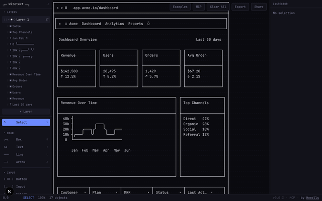
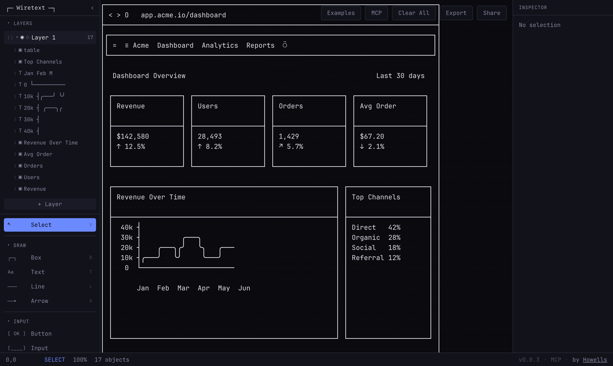
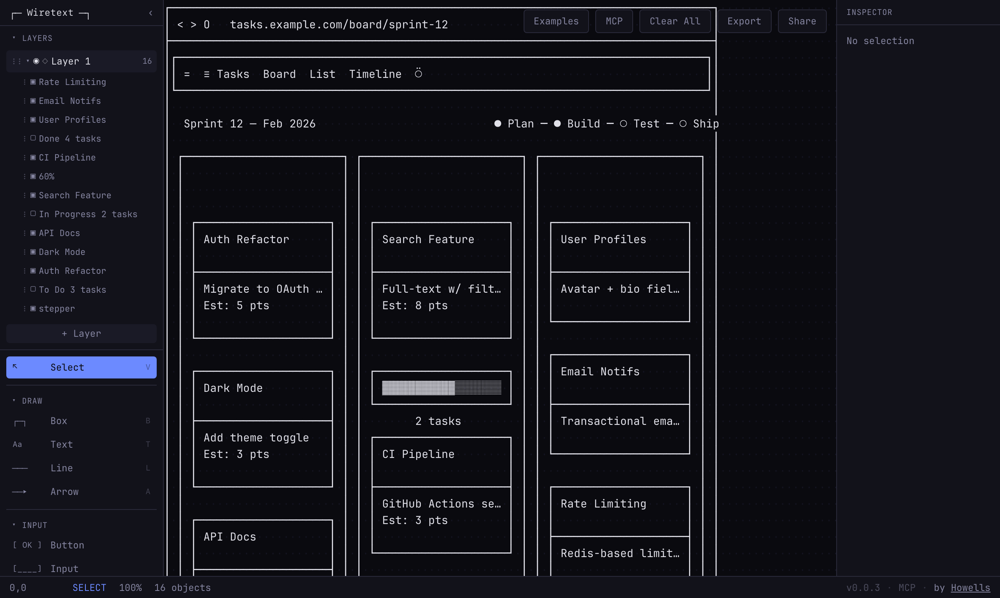

# Wiretext

[](https://github.com/commoninstruments/wiretext/actions/workflows/ci.yml)

Wiretext is a Unicode wireframe design tool for generating editable layouts as plain text. It turns structured JSON into ASCII/Unicode layouts that can be rendered in a terminal, opened in the web editor, or created through an MCP server.



The public value is the reusable tooling:

- `wiretext` — CLI for rendering, creating, and sharing wireframes
- `@wiretext/mcp` — MCP server for typed wireframe generation from AI assistants
- `@wiretext/engine` — layout, composition, validation, sharing, and rendering engine
- `@wiretext/schemas` — Zod schemas for tool and document contracts





## Install

```bash
npm install -g wiretext
```

Or run without installing:

```bash
npx wiretext --help
```

## CLI

Render a wireframe from JSON:

```bash
echo '{ "objects": [{ "type": "box", "label": "Hello", "width": 20, "height": 5 }] }' | wiretext render
```

Create an editable Wiretext URL:

```bash
wiretext create layout.json
```

Create a permanent short URL:

```bash
wiretext share layout.json --dry-run
wiretext share layout.json
```

Use `--dry-run` before `share`; sharing creates a permanent URL through the hosted Wiretext API.

## MCP

Wiretext also ships an MCP server:

```bash
npx -y @wiretext/mcp
```

For Codex:

```toml
[mcp_servers.wiretext]
command = "npx"
args = ["-y", "@wiretext/mcp"]
```

The MCP server exposes typed tools for rendering wireframes and creating editable Wiretext URLs without shell escaping.

## Agent Workflow

Wiretext is designed for coding agents and design agents:

- `wiretext schema` prints the runtime JSON Schema.
- `wiretext context` prints the layout guide agents should read before generating wireframes.
- Non-TTY output defaults to structured JSON.
- Mutating share operations support `--dry-run`.
- Input is validated with Zod before rendering or sharing.

## Hosted vs self-hosted

Most of Wiretext runs entirely offline. Only short-link sharing touches a hosted service.

**Fully offline (no network, no keys):**

- `wiretext render` — renders ASCII/Unicode to stdout
- `wiretext create` — encodes the document into a fragment URL (`https://wiretext.app/#…`); the payload lives in the URL hash, so nothing is uploaded
- `wiretext share --dry-run` — validates and reports encoded size without posting
- `wiretext schema` and `wiretext context`
- The MCP `render_wireframe` tool

**Hits the hosted API:**

- `wiretext share` (without `--dry-run`) and the MCP `create_wireframe` tool `POST` to `https://wiretext.app/api/share` and return a short `/w/:id` URL. Point them at your own deployment with the CLI `--base-url` flag or the MCP `baseUrl` parameter.

**Self-hosting the share endpoint** needs an Upstash Redis instance:

- `UPSTASH_REDIS_REST_URL`
- `UPSTASH_REDIS_REST_TOKEN`

Without these, `/api/share` responds `503` and short links are unavailable — but the editor itself, `wiretext create`, and hash-URL (`#…`) sharing keep working, because the document is carried in the URL rather than stored server-side.

`NEXT_PUBLIC_POSTHOG_KEY` is optional. Analytics is a no-op when it is unset, so a keyless clone still gets the full editor with hash-URL sharing.

See `apps/app/.env.example` for the annotated variable list.

## Workspace

```text
apps/
  app/      Hosted web editor
  cli/      Published `wiretext` CLI
  mcp/      Published `@wiretext/mcp` server
packages/
  engine/   Layout and rendering engine
  schemas/  Shared Zod schemas
```

## Development

Requires Node 24.15+ and pnpm 11 (enable it once with `corepack enable`).

```bash
pnpm install
pnpm dev      # runs the web editor
pnpm check    # lint + typecheck + test
```

Individual tasks are also available: `pnpm build`, `pnpm lint`, `pnpm typecheck`, `pnpm test`.

## Contributing

PRs welcome. Run `pnpm check` before opening one. Contributions are accepted under the MIT license.

## License

MIT
